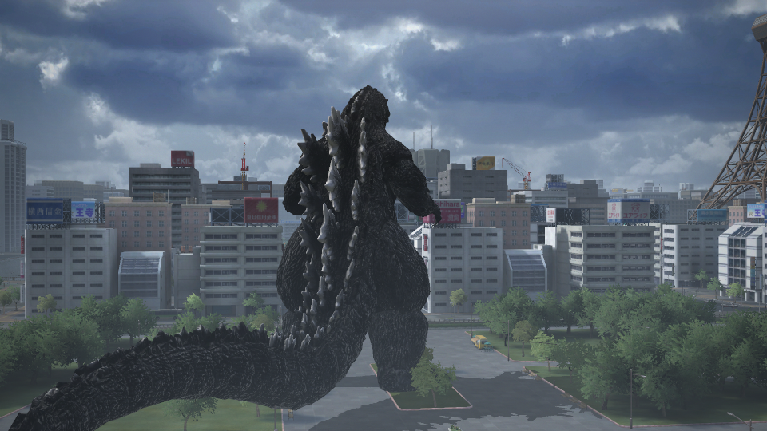
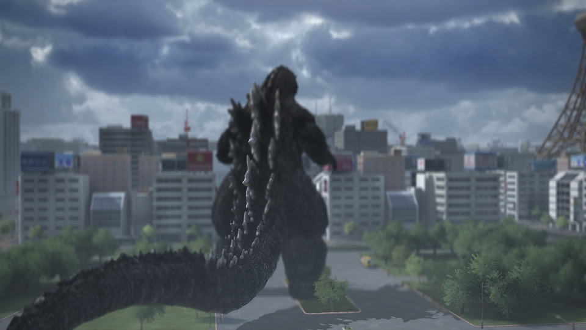
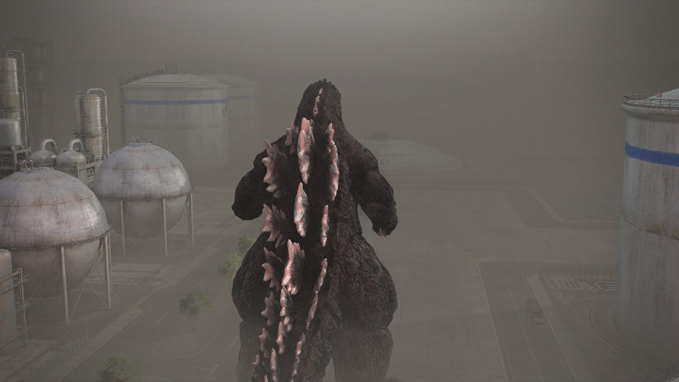

# Godzilla for Windows

**[Download version 1.0.2](https://github.com/DavyBirth/godzilla-pc/releases/latest)** · [What's new](https://github.com/DavyBirth/godzilla-pc/releases/tag/v1.0.2)

Play Godzilla (PS4, 2015) on Windows with a dedicated native runtime, PC controls, a launcher and an expanded photo mode. You supply your own extracted **CUSA02046 game with update 01.01**. No game files or console firmware are distributed here.



## Getting started

1. Download the application ZIP from [Releases](https://github.com/DavyBirth/godzilla-pc/releases/latest) and extract it to a writable folder.
2. Open `Godzilla.exe`. On a new installation, choose **Select game**, select your game's `eboot.bin`, then **Prepare game**. If update 01.01 is in a separate folder, select it using the optional update entry.
3. Once preparation finishes, choose **Play**. The selection and preparation entries disappear when the installation is ready.

The launcher prepares the files locally and bundles the required support tools and Microsoft runtime libraries. You do not need to install an emulator, a compiler, Python or console firmware to play the current release. This is a portable application, without a separate setup wizard. Keep your original game files.

To update, open **Updates → Check for updates → Update**. Existing saves, photos and settings are preserved. Earlier Preview launchers can update through the same menu.

## PC features

| Feature | Available in the current release |
| --- | --- |
| Controls | Keyboard and mouse, plus gamepads; automatic or manual PlayStation, Xbox and Nintendo button prompts |
| Launcher | First-use game preparation, independent game/interface language settings, graphics and control settings, built-in updates |
| Display | Windowed, fullscreen and borderless modes; output resolution, vertical sync, optional AMD FSR 1 and RCAS sharpening |
| Photo mode | Free camera, lens and tilt controls, composition guides, image styles and adjustments, manual focus, three configurable lights, saved adjustment presets and PNG capture |
| Convenience | Local saves, shortcuts to user folders and an optional frame-time/FPS display |

Output resolution and FSR 1 change presentation; they do not increase the original internal rendering resolution. **Internal 4K rendering, DLSS and 120 FPS are not included.**

Useful shortcuts: **Esc** pauses or goes back, **F10** opens photo mode in supported gameplay, **F12** saves a screenshot, and **F3** toggles the performance display. The launcher lists the gameplay controls.

### Photo mode in action

The same scene with blur disabled and with manual depth of field. The second capture uses a manual focus setting to change the sharpness across the scene.

| Blur disabled | Manual depth of field |
| --- | --- |
|  |  |

A separate lighting example, with a colored photo-mode light illuminating Godzilla's dorsal plates:



*Actual unedited in-game captures from photo-mode verification sessions. The HUD and photo menu are hidden; effects come from the runtime, not image editing.*

## Languages

The launcher interface supports **Brazilian Portuguese, English, French, German, Italian, Spanish (Spain), Spanish (Latin America) and Japanese**, plus automatic selection from Windows.

Game text is separate from launcher text. The CUSA02046 installation checked for this release contains **Brazilian Portuguese, English, French and Latin American Spanish**. The launcher offers game languages found in your own data; selecting a different launcher language does not translate the game or add dubbing. Language fallback uses English when the requested game text is unavailable.

## What changes compared with the PS4 game and emulation?

The PC additions include keyboard/mouse controls and matching prompts, selectable controller styles, desktop display settings, the expanded photo mode, PNG capture and the preparation/update launcher.

The original x86-64 game code runs natively on the PC CPU. The runtime supplies the console services it needs, while graphics commands and shaders still use a **shadPS4-derived Vulkan backend**. This is not yet a complete reimplementation of the game.

Compared with running through a general emulator, this package provides a dedicated game launcher and the integrated PC additions above. **No matched gameplay benchmark against shadPS4 is published here**, so higher FPS or fewer pauses than emulation are not claimed.

## Latest improvements: 1.0.2

- Corrected ATRAC9 audio normalization and clipping, checked against complete voice and sound-effect clips from the original audio implementation.
- Corrected three verified close-up photo-mode building material variants so they no longer inherit the gameplay camera's near fade.
- Restored a compatible persistent Vulkan driver cache before pipeline preload, with safe fallback for unusable cache files, atomic saving and improved shutdown cleanup.

Eight local measurements of the same 68-pipeline preload averaged **about 26% less preload time** than the previous cache path. This measures that startup step on one machine; it is not a gameplay FPS gain, a comparison against shadPS4, or a guarantee that loading pauses disappear.

## Earlier video and text fixes

Two of the first issues addressed in this port were flickering prerecorded videos/cutscenes and missing on-screen text, both reported on the emulation setup used during development. The video path was corrected, including the flicker during fades, and compatible fonts restored the previously invisible text. These are results from this project's test setup, not a claim that every emulator or configuration has those problems. Compatibility fonts may differ from the original console font.

## Known limitations

- VS is unavailable because PlayStation online services are not provided.
- Some buildings still become transparent in photo mode, including buildings in front of the tested city area. The 1.0.2 fix covers three verified material variants and does not yet cover the entire scene.
- A reported photo-mode entry failure in the bridge arena has not yet been confirmed resolved.
- Brief loading pauses reported on a GTX remain under investigation.
- Previously collected blank photos are not recovered automatically.

## Source and credits

Project source is available in this repository. The application ZIP also contains `SOURCE.zip`, including the pinned third-party dependencies. Licenses are included. Runtime based on [bbport](https://github.com/deadinside28/bloodborne_pc) and [shadPS4](https://github.com/shadps4-emu/shadPS4), GPL-2.0-or-later. Microsoft runtime libraries have their own license.

Godzilla ©2015 Bandai Namco Entertainment Inc. TM & © TOHO CO., LTD.
Independent project, not affiliated with or endorsed by the rights holders.

## Building from source

Windows 10/11 x64, LLVM/Clang, CMake 3.28+, Ninja, the Windows SDK and Vulkan SDK are required. Python 3 prepares the game image. Run from a developer terminal with the Windows SDK libraries available:

```powershell
git clone --recurse-submodules https://github.com/DavyBirth/godzilla-pc.git
cd godzilla-pc
cmake -S . -B build -G Ninja -DCMAKE_C_COMPILER=clang -DCMAKE_CXX_COMPILER=clang++ -DGZ_DISTRIBUTION_BUILD=ON -DCMAKE_BUILD_TYPE=Release
cmake --build build
```

CMake downloads the remaining dependencies at pinned revisions. Supply your own game data separately; building alone does not prepare a playable installation.

## Code layout

- `src/loader.c`: loads the prepared executable and connects its imports.
- `src/rt_*.c`: Windows implementations of the system services used by the game.
- `src/native_hook.*`: function replacement hooks.
- `src/pc_*`: controls, menus and photo mode.
- `src/*.cs`: launcher, translations and updater.
- `gpu/`: graphics integration; `gpu/vendor/` contains adapted upstream files.
- `scripts/`: preparation and validation of the owner's game files.
- `third_party/`: pinned bbport and shadPS4 source repositories.

Project C/C++ and C# use `.clang-format` (four spaces, 100 columns). Python scripts use Black with a 100-column limit. Keep upstream files and license notices intact.

## AAC decoder maintenance

The runtime uses FFmpeg's native AAC decoder in place of FDK AAC. The build no longer fetches or links FDK AAC. The source package includes the complete FFmpeg 7.1.1 source and its pinned vcpkg build recipe, in addition to the prebuilt wrapper.

After building, run `powershell -NoProfile -File tools/test_ajm_aac.ps1` for isolated AAC checks. Fixtures are generated from a sine wave and silence; they contain no game recordings. `tools/prepare_ffmpeg_source.py` fetches and verifies the complete FFmpeg source for source packaging.

Existing Preview launchers can update to the latest stable release. The legacy `Godzilla-Windows-update.zip` asset is retained alongside the versioned ZIP; both contain the same package.

